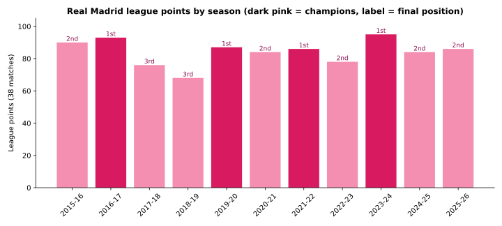
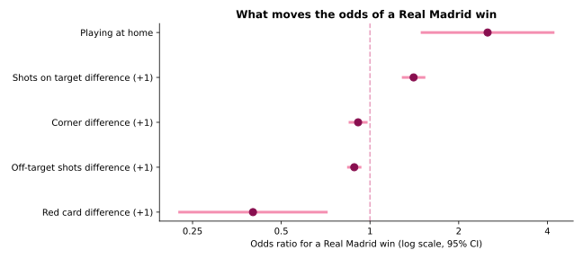
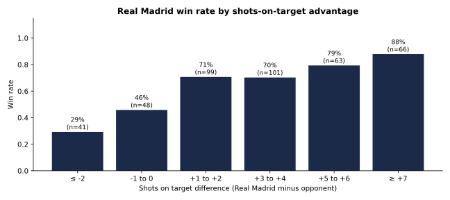
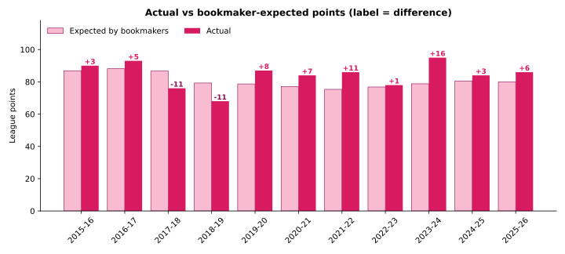

# Real Madrid in La Liga, 2015–2026: What Wins Matches?

**An analysis of 418 Real Madrid league matches across 11 seasons: performance trends, home advantage, the in-game statistics that separate wins from non-wins, and whether bookmakers price the team correctly.**

`Python` · `pandas` · `matplotlib` · `statsmodels` · `scikit-learn` · logistic regression · odds ratios · ROC / AUC · Brier score



---

## Questions

1. How has Real Madrid performed season by season, at home and away?
2. Which in-game statistics separate Real Madrid wins from draws and losses?
3. Do bookmakers price Real Madrid accurately, or does the team over- or under-perform market expectations?

## Data

Every La Liga match from **2015-16 through 2025-26**, from [football-data.co.uk](https://www.football-data.co.uk/spainm.php): 4,180 matches in total, 418 involving Real Madrid, with no missing values.

Variables include full-time and half-time scores, shots, shots on target, corners, fouls, yellow and red cards, and Bet365 pre-match odds. The cleaned file is in [`data/`](data/).

## Method

1. **Reshaping.** Converted home/away match rows into a team-perspective table (goals for and against, shots for and against, home flag, result, points).
2. **League tables.** Rebuilt the final standings for every season from the raw results to get Real Madrid's finishing position.
3. **Benchmarking.** Compared Real Madrid's shot creation, shots allowed and finishing with the rest of La Liga.
4. **Explanatory model.** Logistic regression of *win vs. draw/loss* on shots-on-target difference, off-target shots difference, corner difference, red-card difference and home/away, reported as odds ratios with 95% confidence intervals.
5. **Market analysis.** Converted decimal odds into implied probabilities, removed the bookmaker margin, and compared expected points with actual points by season.
6. **Out-of-sample test.** Trained a pre-match model (home/away plus recent form) on 2015-16 to 2022-23 and tested it on 2023-24 to 2025-26 against the bookmaker's probabilities, using AUC and Brier score.

## Key findings

**1. Consistent and elite.** 4 league titles in 11 seasons, never below 3rd, 2.22 points per game. The 2023-24 season was the best: 95 points and only **1 loss**.

**2. Home advantage is large.**

| | Win rate | Points per game | Goals for | Goals against |
|---|---:|---:|---:|---:|
| Home (Bernabéu) | **75%** | **2.41** | 2.41 | 0.80 |
| Away | 60% | 2.03 | 1.93 | 1.03 |

**3. Shot quality beats shot volume.** Holding other factors fixed:



- Each extra **shot on target** relative to the opponent multiplies the odds of winning by **1.41**.
- **Playing at home** multiplies the odds by **2.5**, even after controlling for shots.
- A **red-card disadvantage** cuts the odds by about **60%**.
- Extra **off-target shots and corners are associated with *lower* odds of winning.** This is a *game state* effect: teams that are behind pile up low-quality shots and corners while chasing the game.

With a shots-on-target edge of +7 or more, Real Madrid won **88%** of matches. With a deficit of 2 or more, it won only **29%**.



**4. The betting market has underrated Real Madrid.** After removing the bookmaker's margin (about 5.4%), Real Madrid beat market-expected points in **9 of 11 seasons**, by about **+39 points in total**. The largest gap was 2023-24 (**+16**). The only shortfalls were 2017-18 and 2018-19 (both about −11).



**5. The market is still hard to beat match by match.** On the 114 matches from the last three seasons, the bookmaker's probabilities (AUC **0.694**, Brier 0.190) outperformed a simple form-plus-venue model (AUC 0.652, Brier 0.197).

## Limitations and next steps

- The data has no expected goals (xG), possession, lineups or injuries, and covers league matches only.
- The win model uses statistics recorded after the match, so it explains wins rather than forecasting them.
- Next steps: add opponent strength ratings (for example Elo), xG data and rest days before European fixtures to improve the pre-match model.

## Repository structure

```
├── real_madrid_analysis.ipynb          # full analysis with code, outputs and written interpretation
├── data/
│   └── laliga_matches_2015_2026.csv    # La Liga match data, 2015-16 to 2025-26
└── images/                             # charts used in this README
```

## How to run

```bash
pip install pandas numpy matplotlib statsmodels scikit-learn jupyter
jupyter notebook real_madrid_analysis.ipynb
```

Run all cells from the repository folder.

---

**Author:** María Sofía Montoya-Chang · M.S. in Data Analytics · [LinkedIn](https://www.linkedin.com/in/maria-montoya-chang)

Data: [football-data.co.uk](https://www.football-data.co.uk/), free historical football results and betting odds data.
